# NCKH ôn thi

> Bản chuyển đổi từ `NCKH_on_thi.pdf`. Mỗi trang được giữ lại dưới dạng ảnh để đối chiếu bố cục, bảng và hình minh họa nguyên bản.

## Trang 1

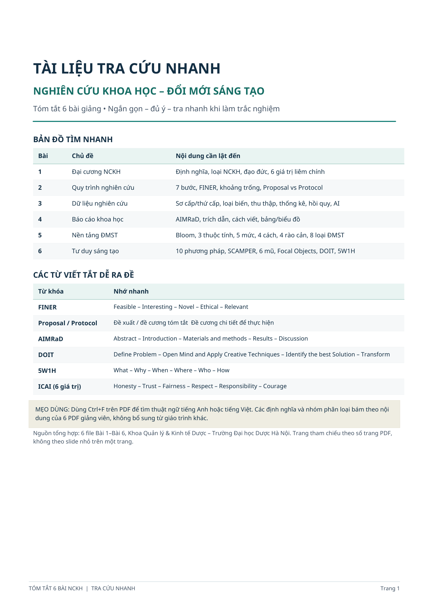

# **TÀI LIỆU TRA CỨU NHANH** 

### **NGHIÊN CỨU KHOA HỌC – ĐỔI MỚI SÁNG TẠO** 

Tóm tắt 6 bài giảng • Ngắn gọn – đủ ý – tra nhanh khi làm trắc nghiệm 

##### **BẢN ĐỒ TÌM NHANH** 

|**Bài**|**Chủ đề**|**Nội dung cần lật đến**|
|---|---|---|
|**1**|Đại cương NCKH|Định nghĩa, loại NCKH, đạo đức, 6 giá trị liêm chính|
|**2**|Quy trình nghiên cứu|7 bước, FINER, khoảng trống, Proposal vs Protocol|
|**3**|Dữ liệu nghiên cứu|Sơ cấp/thứ cấp, loại biến, thu thập, thống kê, hồi quy, AI|
|**4**|Báo cáo khoa học|AIMRaD, trích dẫn, cách viết, bảng/biểu đồ|
|**5**|Nền tảng ĐMST|Bloom, 3 thuộc tính, 5 mức, 4 cách, 4 rào cản, 8 loại ĐMST|
|**6**|Tư duy sáng tạo|10 phương pháp, SCAMPER, 6 mũ, Focal Objects, DOIT, 5W1H|

##### **CÁC TỪ VIẾT TẮT DỄ RA ĐỀ** 

|**Từ khóa**|**Nhớ nhanh**|
|---|---|
|**FINER**|Feasible – Interesting – Novel – Ethical – Relevant|
|**Proposal / Protocol**|Đề xuất / đề cương tóm tắt → Đề cương chi tiết để thực hiện|
|**AIMRaD**|Abstract – Introduction – Materials and methods – Results – Discussion|
|**DOIT**|Define Problem – Open Mind and Apply Creative Techniques – Identify the best Solution – Transform|
|**5W1H**|What – Why – When – Where – Who – How|
|**ICAI (6 giá trị)**|Honesty – Trust – Fairness – Respect – Responsibility – Courage|

MẸO DÙNG: Dùng Ctrl+F trên PDF để tìm thuật ngữ tiếng Anh hoặc tiếng Việt. Các định nghĩa và nhóm phân loại bám theo nội dung của 6 PDF giảng viên, không bổ sung từ giáo trình khác. 

Nguồn tổng hợp: 6 file Bài 1–Bài 6, Khoa Quản lý & Kinh tế Dược – Trường Đại học Dược Hà Nội. Trang tham chiếu theo số trang PDF, không theo slide nhỏ trên một trang. 

TÓM TẮT 6 BÀI NCKH  |  TRA CỨU NHANH 

Trang 1

## Trang 2

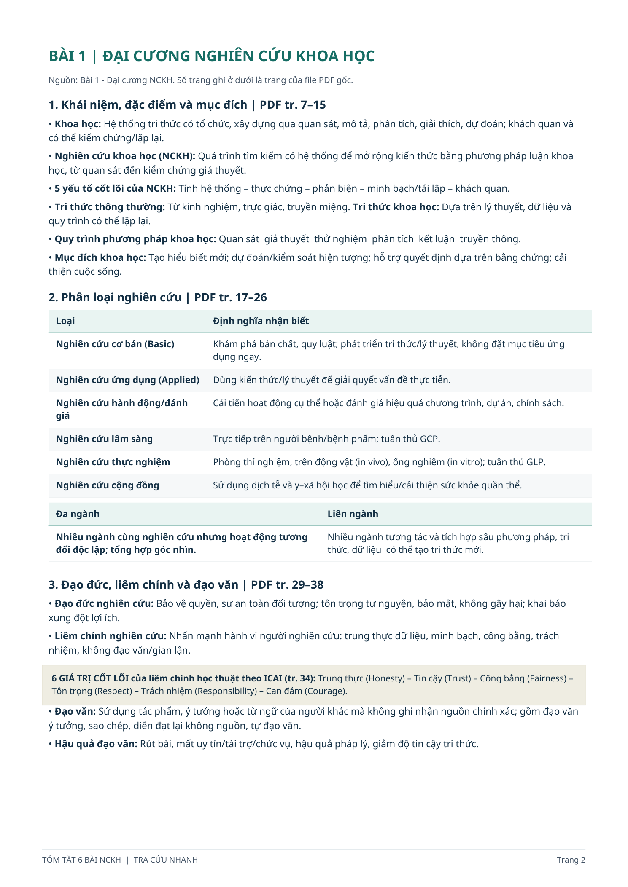

### **BÀI 1 | ĐẠI CƯƠNG NGHIÊN CỨU KHOA HỌC** 

Nguồn: Bài 1 - Đại cương NCKH. Số trang ghi ở dưới là trang của file PDF gốc. 

##### **1. Khái niệm, đặc điểm và mục đích | PDF tr. 7–15** 

- **Khoa học:** Hệ thống tri thức có tổ chức, xây dựng qua quan sát, mô tả, phân tích, giải thích, dự đoán; khách quan và 

- có thể kiểm chứng/lặp lại. 

- **Nghiên cứu khoa học (NCKH):** Quá trình tìm kiếm có hệ thống để mở rộng kiến thức bằng phương pháp luận khoa 

- học, từ quan sát đến kiểm chứng giả thuyết. 

- **5 yếu tố cốt lõi của NCKH:** Tính hệ thống – thực chứng – phản biện – minh bạch/tái lập – khách quan. 

- **Tri thức thông thường:** Từ kinh nghiệm, trực giác, truyền miệng. **Tri thức khoa học:** Dựa trên lý thuyết, dữ liệu và 

- quy trình có thể lặp lại. 

- **Quy trình phương pháp khoa học:** Quan sát → giả thuyết → thử nghiệm → phân tích → kết luận → truyền thông. 

- **Mục đích khoa học:** Tạo hiểu biết mới; dự đoán/kiểm soát hiện tượng; hỗ trợ quyết định dựa trên bằng chứng; cải 

- thiện cuộc sống. 

##### **2. Phân loại nghiên cứu | PDF tr. 17–26** 

|**Loại**|**Định nghĩa nhận biết**|
|---|---|
|**Nghiên cứu cơ bản (Basic)**|Khám phá bản chất, quy luật; phát triển tri thức/lý thuyết, không đặt mục tiêu ứng dụng ngay.|
|**Nghiên cứu ứng dụng (Applied)**|Dùng kiến thức/lý thuyết để giải quyết vấn đề thực tiễn.|
|**Nghiên cứu hành động/đánh** **giá**|Cải tiến hoạt động cụ thể hoặc đánh giá hiệu quả chương trình, dự án, chính sách.|
|**Nghiên cứu lâm sàng**|Trực tiếp trên người bệnh/bệnh phẩm; tuân thủ GCP.|
|**Nghiên cứu thực nghiệm**|Phòng thí nghiệm, trên động vật (in vivo), ống nghiệm (in vitro); tuân thủ GLP.|
|**Nghiên cứu cộng đồng**|Sử dụng dịch tễ và y–xã hội học để tìm hiểu/cải thiện sức khỏe quần thể.|
|**Đa ngành**|**Liên ngành**|
|**Nhiều ngành cùng nghiên cứu nh** **đối độc lập; tổng hợp góc nhìn.**|**ưng hoạt động tương** Nhiều ngành tương tác và tích hợp sâu phương pháp, tri thức, dữ liệu → có thể tạo tri thức mới.|

##### **3. Đạo đức, liêm chính và đạo văn | PDF tr. 29–38** 

- **Đạo đức nghiên cứu:** Bảo vệ quyền, sự an toàn đối tượng; tôn trọng tự nguyện, bảo mật, không gây hại; khai báo 

- xung đột lợi ích. 

- **Liêm chính nghiên cứu:** Nhấn mạnh hành vi người nghiên cứu: trung thực dữ liệu, minh bạch, công bằng, trách 

- nhiệm, không đạo văn/gian lận. 

**6 GIÁ TRỊ CỐT LÕI của liêm chính học thuật theo ICAI (tr. 34):** Trung thực (Honesty) – Tin cậy (Trust) – Công bằng (Fairness) – Tôn trọng (Respect) – Trách nhiệm (Responsibility) – Can đảm (Courage). 

- **Đạo văn:** Sử dụng tác phẩm, ý tưởng hoặc từ ngữ của người khác mà không ghi nhận nguồn chính xác; gồm đạo văn 

- ý tưởng, sao chép, diễn đạt lại không nguồn, tự đạo văn. 

- **Hậu quả đạo văn:** Rút bài, mất uy tín/tài trợ/chức vụ, hậu quả pháp lý, giảm độ tin cậy tri thức. 

TÓM TẮT 6 BÀI NCKH  |  TRA CỨU NHANH 

Trang 2

## Trang 3

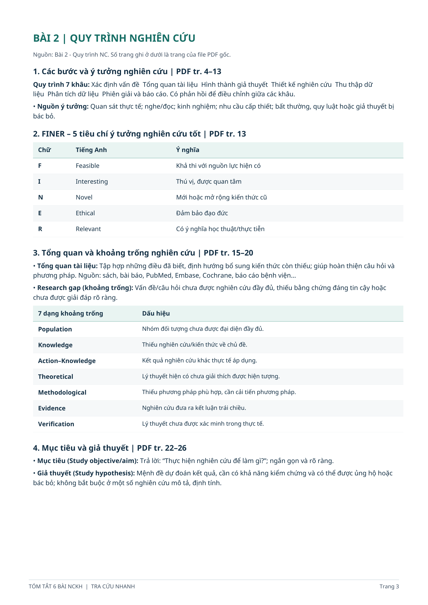

### **BÀI 2 | QUY TRÌNH NGHIÊN CỨU** 

Nguồn: Bài 2 - Quy trình NC. Số trang ghi ở dưới là trang của file PDF gốc. 

##### **1. Các bước và ý tưởng nghiên cứu | PDF tr. 4–13** 

**Quy trình 7 khâu:** Xác định vấn đề → Tổng quan tài liệu → Hình thành giả thuyết → Thiết kế nghiên cứu → Thu thập dữ liệu → Phân tích dữ liệu → Phiên giải và báo cáo. Có phản hồi để điều chỉnh giữa các khâu. 

• **Nguồn ý tưởng:** Quan sát thực tế; nghe/đọc; kinh nghiệm; nhu cầu cấp thiết; bất thường, quy luật hoặc giả thuyết bị bác bỏ. 

##### **2. FINER – 5 tiêu chí ý tưởng nghiên cứu tốt | PDF tr. 13** 

|**Chữ**|**Tiếng Anh**|**Ý nghĩa**|
|---|---|---|
|**F**|Feasible|Khả thi với nguồn lực hiện có|
|**I**|Interesting|Thú vị, được quan tâm|
|**N**|Novel|Mới hoặc mở rộng kiến thức cũ|
|**E**|Ethical|Đảm bảo đạo đức|
|**R**|Relevant|Có ý nghĩa học thuật/thực tiễn|

##### **3. Tổng quan và khoảng trống nghiên cứu | PDF tr. 15–20** 

- **Tổng quan tài liệu:** Tập hợp những điều đã biết, định hướng bổ sung kiến thức còn thiếu; giúp hoàn thiện câu hỏi và 

- phương pháp. Nguồn: sách, bài báo, PubMed, Embase, Cochrane, báo cáo bệnh viện… 

- **Research gap (khoảng trống):** Vấn đề/câu hỏi chưa được nghiên cứu đầy đủ, thiếu bằng chứng đáng tin cậy hoặc 

- chưa được giải đáp rõ ràng. 

|**7 dạng khoảng trống**|**Dấu hiệu**|
|---|---|
|**Population**|Nhóm đối tượng chưa được đại diện đầy đủ.|
|**Knowledge**|Thiếu nghiên cứu/kiến thức về chủ đề.|
|**Action–Knowledge**|Kết quả nghiên cứu khác thực tế áp dụng.|
|**Theoretical**|Lý thuyết hiện có chưa giải thích được hiện tượng.|
|**Methodological**|Thiếu phương pháp phù hợp, cần cải tiến phương pháp.|
|**Evidence**|Nghiên cứu đưa ra kết luận trái chiều.|
|**Verification**|Lý thuyết chưa được xác minh trong thực tế.|

##### **4. Mục tiêu và giả thuyết | PDF tr. 22–26** 

- **Mục tiêu (Study objective/aim):** Trả lời: “Thực hiện nghiên cứu để làm gì?”; ngắn gọn và rõ ràng. 

- **Giả thuyết (Study hypothesis):** Mệnh đề dự đoán kết quả, cần có khả năng kiểm chứng và có thể được ủng hộ hoặc 

- bác bỏ; không bắt buộc ở một số nghiên cứu mô tả, định tính. 

TÓM TẮT 6 BÀI NCKH  |  TRA CỨU NHANH 

Trang 3

## Trang 4

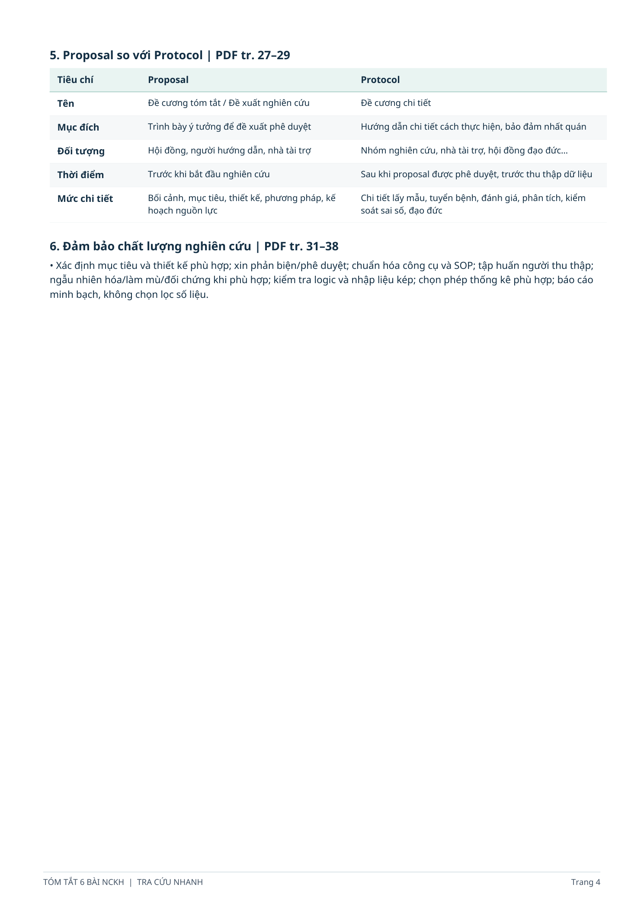

##### **5. Proposal so với Protocol | PDF tr. 27–29** 

|**Tiêu chí**|**Proposal**|**Protocol**|
|---|---|---|
|**Tên**|Đề cương tóm tắt / Đề xuất nghiên cứu|Đề cương chi tiết|
|**Mục đích**|Trình bày ý tưởng để đề xuất phê duyệt|Hướng dẫn chi tiết cách thực hiện, bảo đảm nhất quán|
|**Đối tượng**|Hội đồng, người hướng dẫn, nhà tài trợ|Nhóm nghiên cứu, nhà tài trợ, hội đồng đạo đức…|
|**Thời điểm**|Trước khi bắt đầu nghiên cứu|Sau khi proposal được phê duyệt, trước thu thập dữ liệu|
|**Mức chi tiết**|Bối cảnh, mục tiêu, thiết kế, phương pháp, kế hoạch nguồn lực|Chi tiết lấy mẫu, tuyển bệnh, đánh giá, phân tích, kiểm soát sai số, đạo đức|

##### **6. Đảm bảo chất lượng nghiên cứu | PDF tr. 31–38** 

- Xác định mục tiêu và thiết kế phù hợp; xin phản biện/phê duyệt; chuẩn hóa công cụ và SOP; tập huấn người thu thập; ngẫu nhiên hóa/làm mù/đối chứng khi phù hợp; kiểm tra logic và nhập liệu kép; chọn phép thống kê phù hợp; báo cáo minh bạch, không chọn lọc số liệu. 

TÓM TẮT 6 BÀI NCKH  |  TRA CỨU NHANH 

Trang 4

## Trang 5

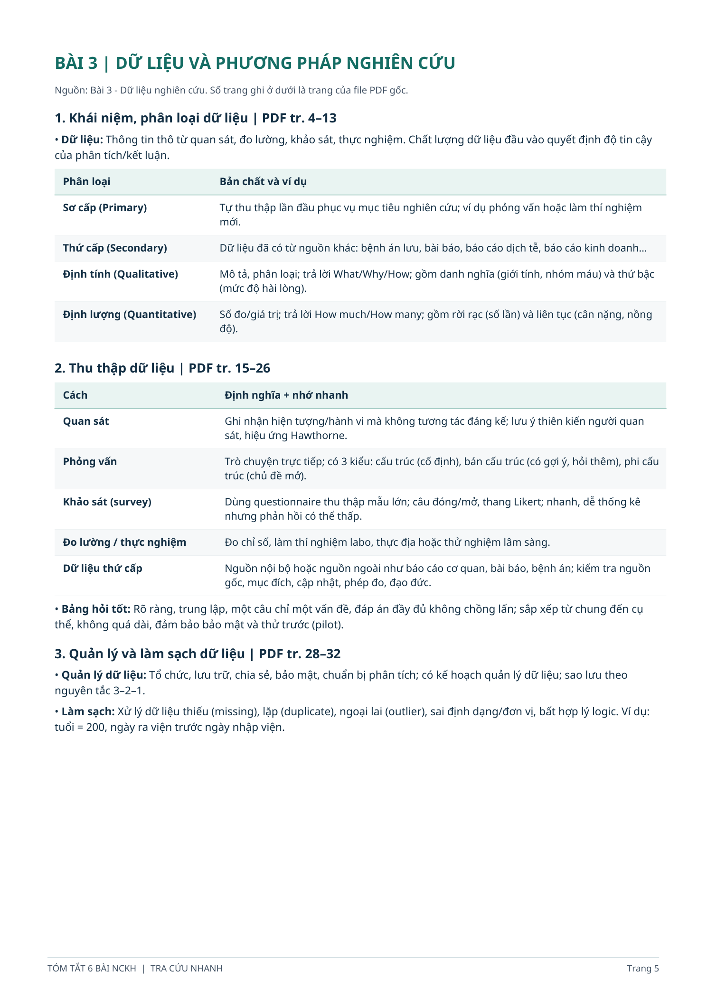

### **BÀI 3 | DỮ LIỆU VÀ PHƯƠNG PHÁP NGHIÊN CỨU** 

Nguồn: Bài 3 - Dữ liệu nghiên cứu. Số trang ghi ở dưới là trang của file PDF gốc. 

##### **1. Khái niệm, phân loại dữ liệu | PDF tr. 4–13** 

- **Dữ liệu:** Thông tin thô từ quan sát, đo lường, khảo sát, thực nghiệm. Chất lượng dữ liệu đầu vào quyết định độ tin cậy 

- của phân tích/kết luận. 

|**Phân loại**|**Bản chất và ví dụ**|
|---|---|
|**Sơ cấp (Primary)**|Tự thu thập lần đầu phục vụ mục tiêu nghiên cứu; ví dụ phỏng vấn hoặc làm thí nghiệm mới.|
|**Thứ cấp (Secondary)**|Dữ liệu đã có từ nguồn khác: bệnh án lưu, bài báo, báo cáo dịch tễ, báo cáo kinh doanh…|
|**Định tính (Qualitative)**|Mô tả, phân loại; trả lời What/Why/How; gồm danh nghĩa (giới tính, nhóm máu) và thứ bậc (mức độ hài lòng).|
|**Định lượng (Quantitative)**|Số đo/giá trị; trả lời How much/How many; gồm rời rạc (số lần) và liên tục (cân nặng, nồng độ).|

##### **2. Thu thập dữ liệu | PDF tr. 15–26** 

|**Cách**|**Định nghĩa + nhớ nhanh**|
|---|---|
|**Quan sát**|Ghi nhận hiện tượng/hành vi mà không tương tác đáng kể; lưu ý thiên kiến người quan sát, hiệu ứng Hawthorne.|
|**Phỏng vấn**|Trò chuyện trực tiếp; có 3 kiểu: cấu trúc (cố định), bán cấu trúc (có gợi ý, hỏi thêm), phi cấu trúc (chủ đề mở).|
|**Khảo sát (survey)**|Dùng questionnaire thu thập mẫu lớn; câu đóng/mở, thang Likert; nhanh, dễ thống kê nhưng phản hồi có thể thấp.|
|**Đo lường / thực nghiệm**|Đo chỉ số, làm thí nghiệm labo, thực địa hoặc thử nghiệm lâm sàng.|
|**Dữ liệu thứ cấp**|Nguồn nội bộ hoặc nguồn ngoài như báo cáo cơ quan, bài báo, bệnh án; kiểm tra nguồn gốc, mục đích, cập nhật, phép đo, đạo đức.|

• **Bảng hỏi tốt:** Rõ ràng, trung lập, một câu chỉ một vấn đề, đáp án đầy đủ không chồng lấn; sắp xếp từ chung đến cụ thể, không quá dài, đảm bảo bảo mật và thử trước (pilot). 

##### **3. Quản lý và làm sạch dữ liệu | PDF tr. 28–32** 

- **Quản lý dữ liệu:** Tổ chức, lưu trữ, chia sẻ, bảo mật, chuẩn bị phân tích; có kế hoạch quản lý dữ liệu; sao lưu theo 

- nguyên tắc 3–2–1. 

- **Làm sạch:** Xử lý dữ liệu thiếu (missing), lặp (duplicate), ngoại lai (outlier), sai định dạng/đơn vị, bất hợp lý logic. Ví dụ: 

- tuổi = 200, ngày ra viện trước ngày nhập viện. 

TÓM TẮT 6 BÀI NCKH  |  TRA CỨU NHANH 

Trang 5

## Trang 6

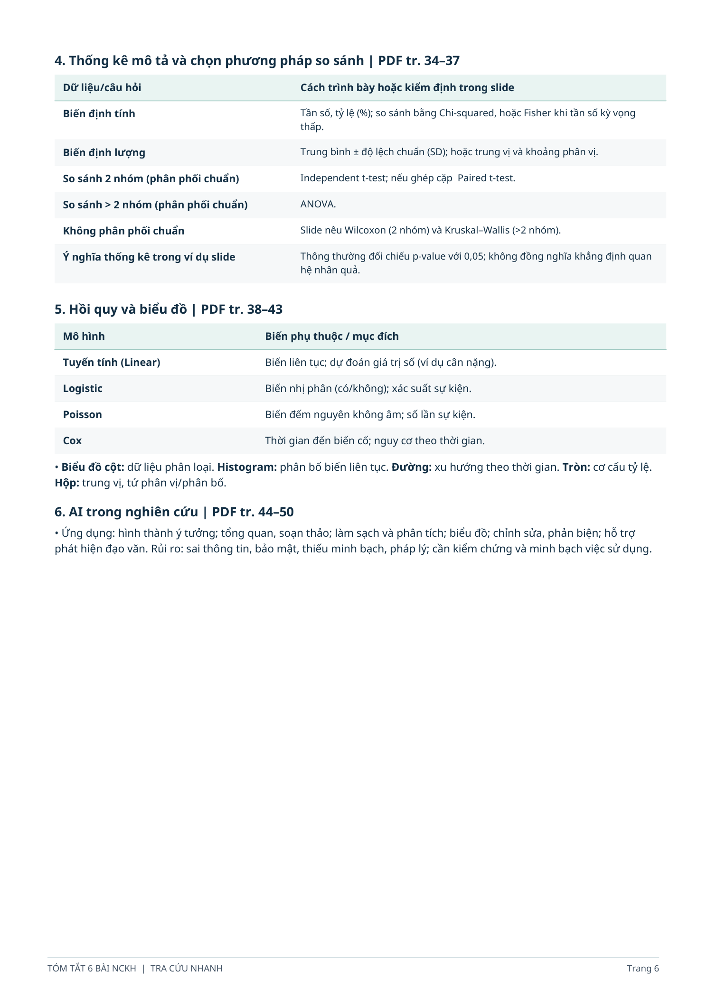

##### **4. Thống kê mô tả và chọn phương pháp so sánh | PDF tr. 34–37** 

|**Dữ liệu/câu hỏi**|**Cách trình bày hoặc kiểm định trong slide**|
|---|---|
|**Biến định tính**|Tần số, tỷ lệ (%); so sánh bằng Chi-squared, hoặc Fisher khi tần số kỳ vọng thấp.|
|**Biến định lượng**|Trung bình ± độ lệch chuẩn (SD); hoặc trung vị và khoảng phân vị.|
|**So sánh 2 nhóm (phân phối chuẩn)**|Independent t-test; nếu ghép cặp → Paired t-test.|
|**So sánh > 2 nhóm (phân phối chuẩn)**|ANOVA.|
|**Không phân phối chuẩn**|Slide nêu Wilcoxon (2 nhóm) và Kruskal–Wallis (>2 nhóm).|
|**Ý nghĩa thống kê trong ví dụ slide**|Thông thường đối chiếu p-value với 0,05; không đồng nghĩa khẳng định quan hệ nhân quả.|

##### **5. Hồi quy và biểu đồ | PDF tr. 38–43** 

|**Mô hình**|**Biến phụ thuộc / mục đích**|
|---|---|
|**Tuyến tính (Linear)**|Biến liên tục; dự đoán giá trị số (ví dụ cân nặng).|
|**Logistic**|Biến nhị phân (có/không); xác suất sự kiện.|
|**Poisson**|Biến đếm nguyên không âm; số lần sự kiện.|
|**Cox**|Thời gian đến biến cố; nguy cơ theo thời gian.|

• **Biểu đồ cột:** dữ liệu phân loại. **Histogram:** phân bố biến liên tục. **Đường:** xu hướng theo thời gian. **Tròn:** cơ cấu tỷ lệ. **Hộp:** trung vị, tứ phân vị/phân bố. 

##### **6. AI trong nghiên cứu | PDF tr. 44–50** 

• Ứng dụng: hình thành ý tưởng; tổng quan, soạn thảo; làm sạch và phân tích; biểu đồ; chỉnh sửa, phản biện; hỗ trợ phát hiện đạo văn. Rủi ro: sai thông tin, bảo mật, thiếu minh bạch, pháp lý; cần kiểm chứng và minh bạch việc sử dụng. 

TÓM TẮT 6 BÀI NCKH  |  TRA CỨU NHANH 

Trang 6

## Trang 7

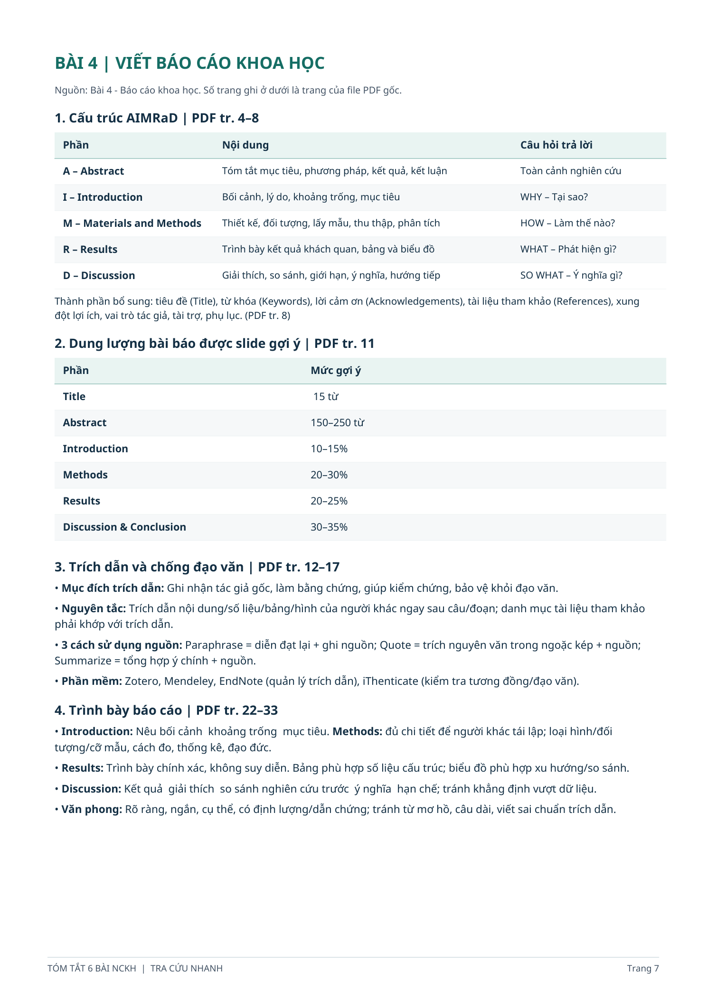

### **BÀI 4 | VIẾT BÁO CÁO KHOA HỌC** 

Nguồn: Bài 4 - Báo cáo khoa học. Số trang ghi ở dưới là trang của file PDF gốc. 

##### **1. Cấu trúc AIMRaD | PDF tr. 4–8** 

|**Phần**|**Nội dung**|**Câu hỏi trả lời**|
|---|---|---|
|**A – Abstract**|Tóm tắt mục tiêu, phương pháp, kết quả, kết luận|Toàn cảnh nghiên cứu|
|**I – Introduction**|Bối cảnh, lý do, khoảng trống, mục tiêu|WHY – Tại sao?|
|**M – Materials and Methods**|Thiết kế, đối tượng, lấy mẫu, thu thập, phân tích|HOW – Làm thế nào?|
|**R – Results**|Trình bày kết quả khách quan, bảng và biểu đồ|WHAT – Phát hiện gì?|
|**D – Discussion**|Giải thích, so sánh, giới hạn, ý nghĩa, hướng tiếp|SO WHAT – Ý nghĩa gì?|

Thành phần bổ sung: tiêu đề (Title), từ khóa (Keywords), lời cảm ơn (Acknowledgements), tài liệu tham khảo (References), xung đột lợi ích, vai trò tác giả, tài trợ, phụ lục. (PDF tr. 8) 

##### **2. Dung lượng bài báo được slide gợi ý | PDF tr. 11** 

|**Phần**|**Mức gợi ý**|
|---|---|
|**Title**|≤ 15 từ|
|**Abstract**|150–250 từ|
|**Introduction**|10–15%|
|**Methods**|20–30%|
|**Results**|20–25%|
|**Discussion & Conclusion**|30–35%|

##### **3. Trích dẫn và chống đạo văn | PDF tr. 12–17** 

- **Mục đích trích dẫn:** Ghi nhận tác giả gốc, làm bằng chứng, giúp kiểm chứng, bảo vệ khỏi đạo văn. 

- **Nguyên tắc:** Trích dẫn nội dung/số liệu/bảng/hình của người khác ngay sau câu/đoạn; danh mục tài liệu tham khảo 

- phải khớp với trích dẫn. 

- **3 cách sử dụng nguồn:** Paraphrase = diễn đạt lại + ghi nguồn; Quote = trích nguyên văn trong ngoặc kép + nguồn; 

- Summarize = tổng hợp ý chính + nguồn. 

- **Phần mềm:** Zotero, Mendeley, EndNote (quản lý trích dẫn), iThenticate (kiểm tra tương đồng/đạo văn). 

##### **4. Trình bày báo cáo | PDF tr. 22–33** 

- **Introduction:** Nêu bối cảnh → khoảng trống → mục tiêu. **Methods:** đủ chi tiết để người khác tái lập; loại hình/đối 

- tượng/cỡ mẫu, cách đo, thống kê, đạo đức. 

- **Results:** Trình bày chính xác, không suy diễn. Bảng phù hợp số liệu cấu trúc; biểu đồ phù hợp xu hướng/so sánh. 

- **Discussion:** Kết quả → giải thích → so sánh nghiên cứu trước → ý nghĩa → hạn chế; tránh khẳng định vượt dữ liệu. 

- **Văn phong:** Rõ ràng, ngắn, cụ thể, có định lượng/dẫn chứng; tránh từ mơ hồ, câu dài, viết sai chuẩn trích dẫn. 

TÓM TẮT 6 BÀI NCKH  |  TRA CỨU NHANH 

Trang 7

## Trang 8

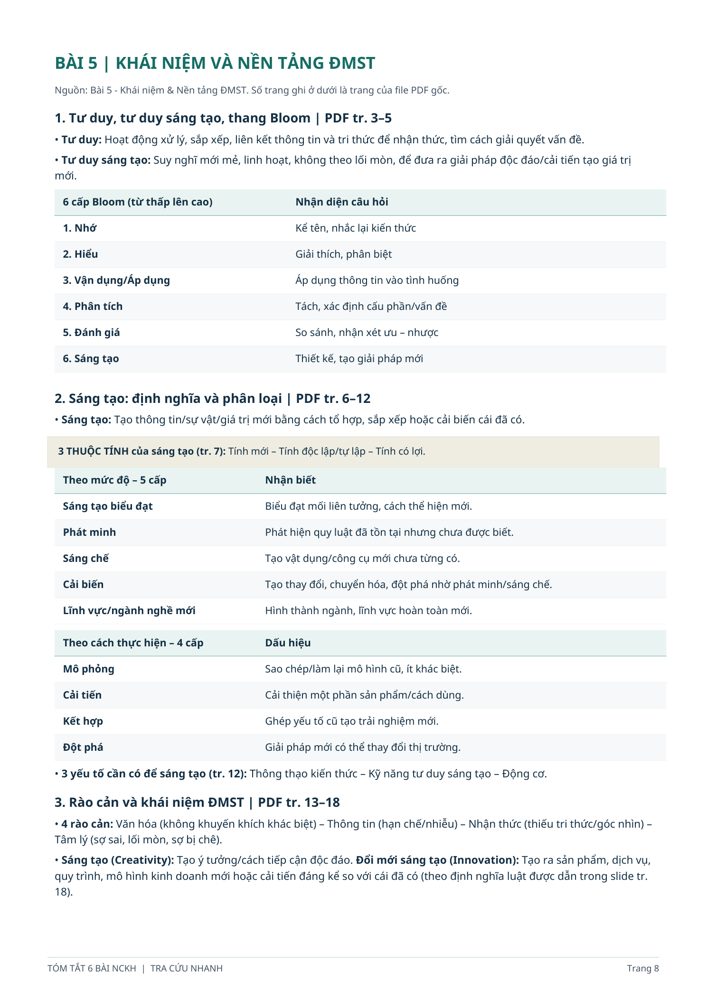

### **BÀI 5 | KHÁI NIỆM VÀ NỀN TẢNG ĐMST** 

Nguồn: Bài 5 - Khái niệm & Nền tảng ĐMST. Số trang ghi ở dưới là trang của file PDF gốc. 

##### **1. Tư duy, tư duy sáng tạo, thang Bloom | PDF tr. 3–5** 

- **Tư duy:** Hoạt động xử lý, sắp xếp, liên kết thông tin và tri thức để nhận thức, tìm cách giải quyết vấn đề. 

- **Tư duy sáng tạo:** Suy nghĩ mới mẻ, linh hoạt, không theo lối mòn, để đưa ra giải pháp độc đáo/cải tiến tạo giá trị 

- mới. 

|**6 cấp Bloom (từ thấp lên cao)**|**Nhận diện câu hỏi**|
|---|---|
|**1. Nhớ**|Kể tên, nhắc lại kiến thức|
|**2. Hiểu**|Giải thích, phân biệt|
|**3. Vận dụng/Áp dụng**|Áp dụng thông tin vào tình huống|
|**4. Phân tích**|Tách, xác định cấu phần/vấn đề|
|**5. Đánh giá**|So sánh, nhận xét ưu – nhược|
|**6. Sáng tạo**|Thiết kế, tạo giải pháp mới|

##### **2. Sáng tạo: định nghĩa và phân loại | PDF tr. 6–12** 

- **Sáng tạo:** Tạo thông tin/sự vật/giá trị mới bằng cách tổ hợp, sắp xếp hoặc cải biến cái đã có. 

|**3 THUỘC TÍNH của sáng tạo (tr. 7):**T|ính mới – Tính độc lập/tự lập – Tính có lợi.|
|---|---|
|**Theo mức độ – 5 cấp**|**Nhận biết**|
|**Sáng tạo biểu đạt**|Biểu đạt mối liên tưởng, cách thể hiện mới.|
|**Phát minh**|Phát hiện quy luật đã tồn tại nhưng chưa được biết.|
|**Sáng chế**|Tạo vật dụng/công cụ mới chưa từng có.|
|**Cải biến**|Tạo thay đổi, chuyển hóa, đột phá nhờ phát minh/sáng chế.|
|**Lĩnh vực/ngành nghề mới**|Hình thành ngành, lĩnh vực hoàn toàn mới.|
|**Theo cách thực hiện – 4 cấp**|**Dấu hiệu**|
|**Mô phỏng**|Sao chép/làm lại mô hình cũ, ít khác biệt.|
|**Cải tiến**|Cải thiện một phần sản phẩm/cách dùng.|
|**Kết hợp**|Ghép yếu tố cũ tạo trải nghiệm mới.|
|**Đột phá**|Giải pháp mới có thể thay đổi thị trường.|

- **3 yếu tố cần có để sáng tạo (tr. 12):** Thông thạo kiến thức – Kỹ năng tư duy sáng tạo – Động cơ. 

##### **3. Rào cản và khái niệm ĐMST | PDF tr. 13–18** 

- **4 rào cản:** Văn hóa (không khuyến khích khác biệt) – Thông tin (hạn chế/nhiễu) – Nhận thức (thiếu tri thức/góc nhìn) – 

- Tâm lý (sợ sai, lối mòn, sợ bị chê). 

- **Sáng tạo (Creativity):** Tạo ý tưởng/cách tiếp cận độc đáo. **Đổi mới sáng tạo (Innovation):** Tạo ra sản phẩm, dịch vụ, 

- quy trình, mô hình kinh doanh mới hoặc cải tiến đáng kể so với cái đã có (theo định nghĩa luật được dẫn trong slide tr. 18). 

TÓM TẮT 6 BÀI NCKH  |  TRA CỨU NHANH 

Trang 8

## Trang 9

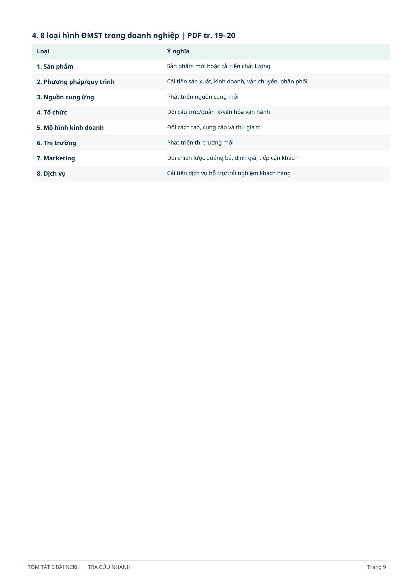

##### **4. 8 loại hình ĐMST trong doanh nghiệp | PDF tr. 19–20** 

|**Loại**|**Ý nghĩa**|
|---|---|
|**1. Sản phẩm**|Sản phẩm mới hoặc cải tiến chất lượng|
|**2. Phương pháp/quy trình**|Cải tiến sản xuất, kinh doanh, vận chuyển, phân phối|
|**3. Nguồn cung ứng**|Phát triển nguồn cung mới|
|**4. Tổ chức**|Đổi cấu trúc/quản lý/văn hóa vận hành|
|**5. Mô hình kinh doanh**|Đổi cách tạo, cung cấp và thu giá trị|
|**6. Thị trường**|Phát triển thị trường mới|
|**7. Marketing**|Đổi chiến lược quảng bá, định giá, tiếp cận khách|
|**8. Dịch vụ**|Cải tiến dịch vụ hỗ trợ/trải nghiệm khách hàng|

TÓM TẮT 6 BÀI NCKH  |  TRA CỨU NHANH 

Trang 9

## Trang 10

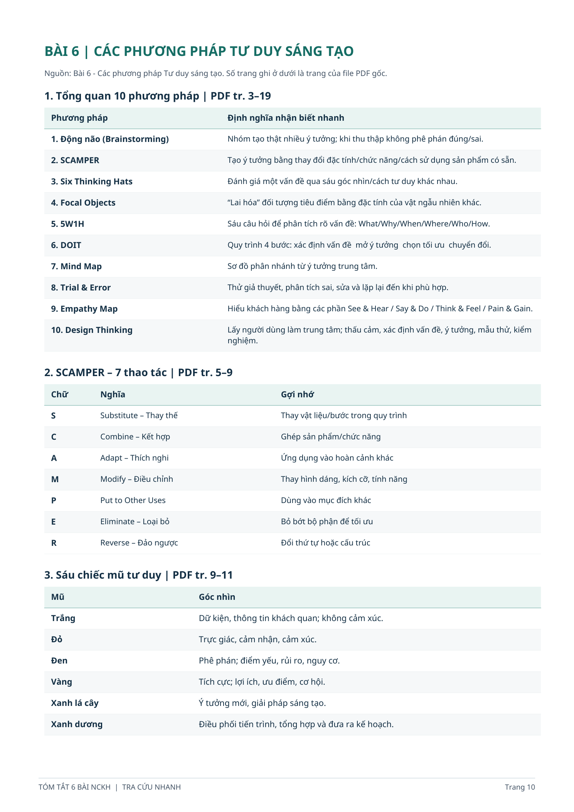

### **BÀI 6 | CÁC PHƯƠNG PHÁP TƯ DUY SÁNG TẠO** 

Nguồn: Bài 6 - Các phương pháp Tư duy sáng tạo. Số trang ghi ở dưới là trang của file PDF gốc. 

##### **1. Tổng quan 10 phương pháp | PDF tr. 3–19** 

|**Phương pháp**|**Định nghĩa nhận biết nhanh**|
|---|---|
|**1. Động não (Brainstorming)**|Nhóm tạo thật nhiều ý tưởng; khi thu thập không phê phán đúng/sai.|
|**2. SCAMPER**|Tạo ý tưởng bằng thay đổi đặc tính/chức năng/cách sử dụng sản phẩm có sẵn.|
|**3. Six Thinking Hats**|Đánh giá một vấn đề qua sáu góc nhìn/cách tư duy khác nhau.|
|**4. Focal Objects**|“Lai hóa” đối tượng tiêu điểm bằng đặc tính của vật ngẫu nhiên khác.|
|**5. 5W1H**|Sáu câu hỏi để phân tích rõ vấn đề: What/Why/When/Where/Who/How.|
|**6. DOIT**|Quy trình 4 bước: xác định vấn đề → mở ý tưởng → chọn tối ưu → chuyển đổi.|
|**7. Mind Map**|Sơ đồ phân nhánh từ ý tưởng trung tâm.|
|**8. Trial & Error**|Thử giả thuyết, phân tích sai, sửa và lặp lại đến khi phù hợp.|
|**9. Empathy Map**|Hiểu khách hàng bằng các phần See & Hear / Say & Do / Think & Feel / Pain & Gain.|
|**10. Design Thinking**|Lấy người dùng làm trung tâm; thấu cảm, xác định vấn đề, ý tưởng, mẫu thử, kiểm nghiệm.|

##### **2. SCAMPER – 7 thao tác | PDF tr. 5–9** 

|**Chữ**|**Nghĩa**|**Gợi nhớ**|
|---|---|---|
|**S**|Substitute – Thay thế|Thay vật liệu/bước trong quy trình|
|**C**|Combine – Kết hợp|Ghép sản phẩm/chức năng|
|**A**|Adapt – Thích nghi|Ứng dụng vào hoàn cảnh khác|
|**M**|Modify – Điều chỉnh|Thay hình dáng, kích cỡ, tính năng|
|**P**|Put to Other Uses|Dùng vào mục đích khác|
|**E**|Eliminate – Loại bỏ|Bỏ bớt bộ phận để tối ưu|
|**R**|Reverse – Đảo ngược|Đổi thứ tự hoặc cấu trúc|

##### **3. Sáu chiếc mũ tư duy | PDF tr. 9–11** 

|**Mũ**|**Góc nhìn**|
|---|---|
|**Trắng**|Dữ kiện, thông tin khách quan; không cảm xúc.|
|**Đỏ**|Trực giác, cảm nhận, cảm xúc.|
|**Đen**|Phê phán; điểm yếu, rủi ro, nguy cơ.|
|**Vàng**|Tích cực; lợi ích, ưu điểm, cơ hội.|
|**Xanh lá cây**|Ý tưởng mới, giải pháp sáng tạo.|
|**Xanh dương**|Điều phối tiến trình, tổng hợp và đưa ra kế hoạch.|

TÓM TẮT 6 BÀI NCKH  |  TRA CỨU NHANH 

Trang 10

## Trang 11

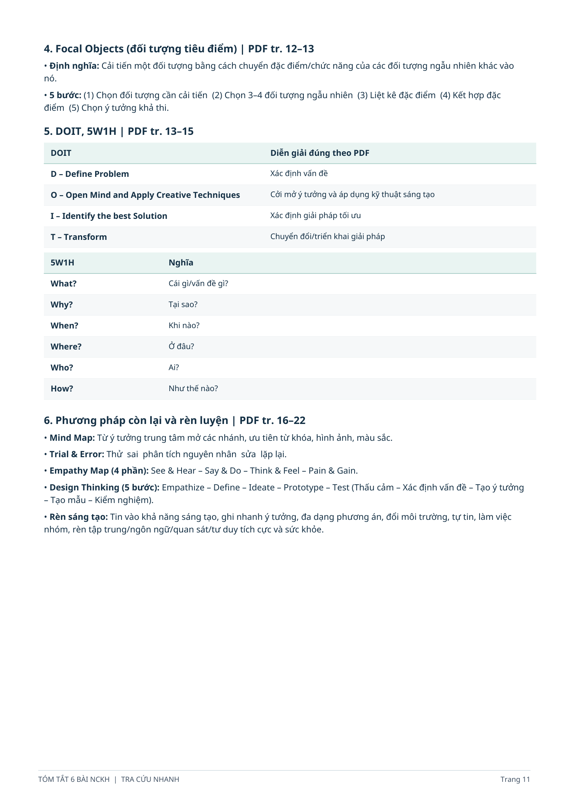

##### **4. Focal Objects (đối tượng tiêu điểm) | PDF tr. 12–13** 

- **Định nghĩa:** Cải tiến một đối tượng bằng cách chuyển đặc điểm/chức năng của các đối tượng ngẫu nhiên khác vào 

- nó. 

- **5 bước:** (1) Chọn đối tượng cần cải tiến → (2) Chọn 3–4 đối tượng ngẫu nhiên → (3) Liệt kê đặc điểm → (4) Kết hợp đặc 

- điểm → (5) Chọn ý tưởng khả thi. 

##### **5. DOIT, 5W1H | PDF tr. 13–15** 

|**DOIT**|**Diễn giải đúng theo PDF**|
|---|---|
|**D – Define Problem**|Xác định vấn đề|
|**O – Open Mind and Apply Creative Techniques**|Cởi mở ý tưởng và áp dụng kỹ thuật sáng tạo|
|**I – Identify the best Solution**|Xác định giải pháp tối ưu|
|**T – Transform**|Chuyển đổi/triển khai giải pháp|

|**5W1H**|**Nghĩa**|
|---|---|
|**What?**|Cái gì/vấn đề gì?|
|**Why?**|Tại sao?|
|**When?**|Khi nào?|
|**Where?**|Ở đâu?|
|**Who?**|Ai?|
|**How?**|Như thế nào?|

##### **6. Phương pháp còn lại và rèn luyện | PDF tr. 16–22** 

- **Mind Map:** Từ ý tưởng trung tâm mở các nhánh, ưu tiên từ khóa, hình ảnh, màu sắc. 

- **Trial & Error:** Thử → sai → phân tích nguyên nhân → sửa → lặp lại. 

- **Empathy Map (4 phần):** See & Hear – Say & Do – Think & Feel – Pain & Gain. 

- **Design Thinking (5 bước):** Empathize – Define – Ideate – Prototype – Test (Thấu cảm – Xác định vấn đề – Tạo ý tưởng 

- – Tạo mẫu – Kiểm nghiệm). 

- **Rèn sáng tạo:** Tin vào khả năng sáng tạo, ghi nhanh ý tưởng, đa dạng phương án, đổi môi trường, tự tin, làm việc 

- nhóm, rèn tập trung/ngôn ngữ/quan sát/tư duy tích cực và sức khỏe. 

TÓM TẮT 6 BÀI NCKH  |  TRA CỨU NHANH 

Trang 11

## Trang 12

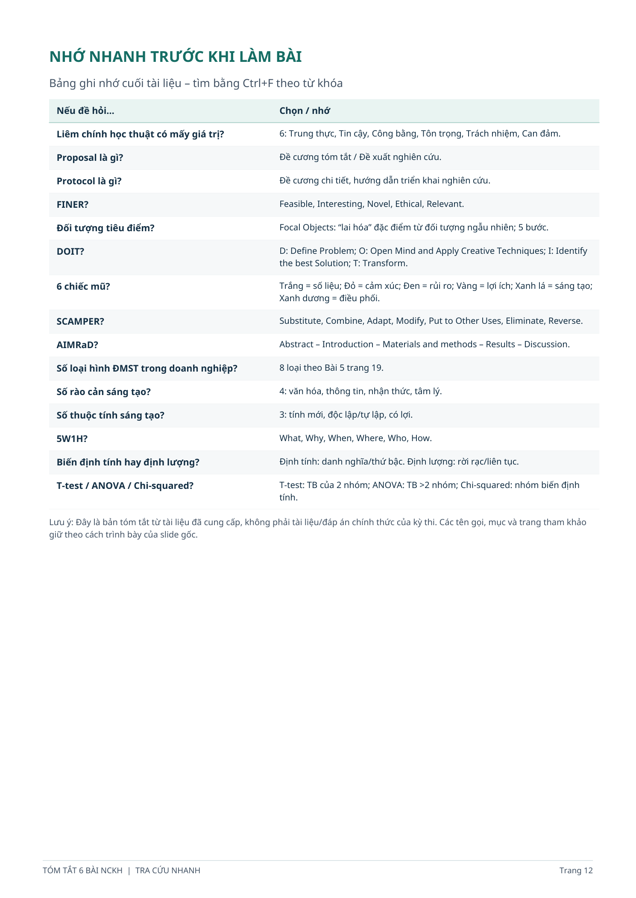

### **NHỚ NHANH TRƯỚC KHI LÀM BÀI** 

Bảng ghi nhớ cuối tài liệu – tìm bằng Ctrl+F theo từ khóa 

|**Nếu đề hỏi…**|**Chọn / nhớ**|
|---|---|
|**Liêm chính học thuật có mấy giá trị?**|6: Trung thực, Tin cậy, Công bằng, Tôn trọng, Trách nhiệm, Can đảm.|
|**Proposal là gì?**|Đề cương tóm tắt / Đề xuất nghiên cứu.|
|**Protocol là gì?**|Đề cương chi tiết, hướng dẫn triển khai nghiên cứu.|
|**FINER?**|Feasible, Interesting, Novel, Ethical, Relevant.|
|**Đối tượng tiêu điểm?**|Focal Objects: “lai hóa” đặc điểm từ đối tượng ngẫu nhiên; 5 bước.|
|**DOIT?**|D: Define Problem; O: Open Mind and Apply Creative Techniques; I: Identify the best Solution; T: Transform.|
|**6 chiếc mũ?**|Trắng = số liệu; Đỏ = cảm xúc; Đen = rủi ro; Vàng = lợi ích; Xanh lá = sáng tạo; Xanh dương = điều phối.|
|**SCAMPER?**|Substitute, Combine, Adapt, Modify, Put to Other Uses, Eliminate, Reverse.|
|**AIMRaD?**|Abstract – Introduction – Materials and methods – Results – Discussion.|
|**Số loại hình ĐMST trong doanh nghiệp?**|8 loại theo Bài 5 trang 19.|
|**Số rào cản sáng tạo?**|4: văn hóa, thông tin, nhận thức, tâm lý.|
|**Số thuộc tính sáng tạo?**|3: tính mới, độc lập/tự lập, có lợi.|
|**5W1H?**|What, Why, When, Where, Who, How.|
|**Biến định tính hay định lượng?**|Định tính: danh nghĩa/thứ bậc. Định lượng: rời rạc/liên tục.|
|**T-test / ANOVA / Chi-squared?**|T-test: TB của 2 nhóm; ANOVA: TB >2 nhóm; Chi-squared: nhóm biến định tính.|

Lưu ý: Đây là bản tóm tắt từ tài liệu đã cung cấp, không phải tài liệu/đáp án chính thức của kỳ thi. Các tên gọi, mục và trang tham khảo giữ theo cách trình bày của slide gốc. 

TÓM TẮT 6 BÀI NCKH  |  TRA CỨU NHANH 

Trang 12

## Trang 13

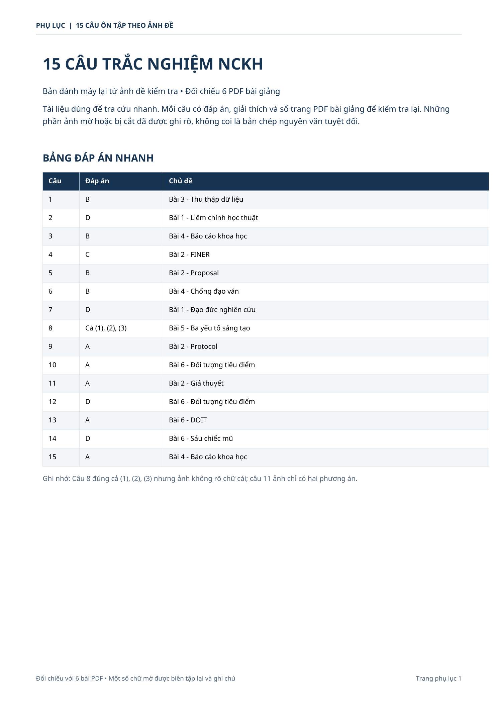

**PHỤ LỤC  |  15 CÂU ÔN TẬP THEO ẢNH ĐỀ** 

## **15 CÂU TRẮC NGHIỆM NCKH** 

Bản đánh máy lại từ ảnh đề kiểm tra • Đối chiếu 6 PDF bài giảng 

Tài liệu dùng để tra cứu nhanh. Mỗi câu có đáp án, giải thích và số trang PDF bài giảng để kiểm tra lại. Những phần ảnh mờ hoặc bị cắt đã được ghi rõ, không coi là bản chép nguyên văn tuyệt đối. 

#### **BẢNG ĐÁP ÁN NHANH** 

|**Câu**|**Đáp án**|**Chủ đề**|
|---|---|---|
|1|B|Bài 3 - Thu thập dữ liệu|
|2|D|Bài 1 - Liêm chính học thuật|
|3|B|Bài 4 - Báo cáo khoa học|
|4|C|Bài 2 - FINER|
|5|B|Bài 2 - Proposal|
|6|B|Bài 4 - Chống đạo văn|
|7|D|Bài 1 - Đạo đức nghiên cứu|
|8|Cả (1), (2), (3)|Bài 5 - Ba yếu tố sáng tạo|
|9|A|Bài 2 - Protocol|
|10|A|Bài 6 - Đối tượng tiêu điểm|
|11|A|Bài 2 - Giả thuyết|
|12|D|Bài 6 - Đối tượng tiêu điểm|
|13|A|Bài 6 - DOIT|
|14|D|Bài 6 - Sáu chiếc mũ|
|15|A|Bài 4 - Báo cáo khoa học|

Ghi nhớ: Câu 8 đúng cả (1), (2), (3) nhưng ảnh không rõ chữ cái; câu 11 ảnh chỉ có hai phương án. 

Đối chiếu với 6 bài PDF • Một số chữ mờ được biên tập lại và ghi chú 

Trang phụ lục 1

## Trang 14

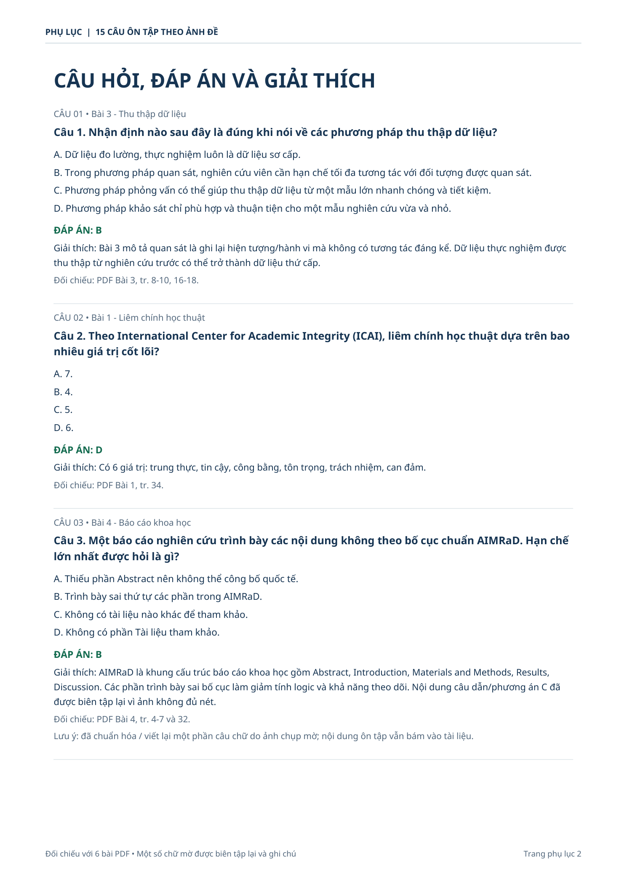

**PHỤ LỤC  |  15 CÂU ÔN TẬP THEO ẢNH ĐỀ** 

## **CÂU HỎI, ĐÁP ÁN VÀ GIẢI THÍCH** 

CÂU 01 • Bài 3 - Thu thập dữ liệu 

###### **Câu 1. Nhận định nào sau đây là đúng khi nói về các phương pháp thu thập dữ liệu?** 

- A. Dữ liệu đo lường, thực nghiệm luôn là dữ liệu sơ cấp. 

- B. Trong phương pháp quan sát, nghiên cứu viên cần hạn chế tối đa tương tác với đối tượng được quan sát. 

- C. Phương pháp phỏng vấn có thể giúp thu thập dữ liệu từ một mẫu lớn nhanh chóng và tiết kiệm. 

- D. Phương pháp khảo sát chỉ phù hợp và thuận tiện cho một mẫu nghiên cứu vừa và nhỏ. 

###### **ĐÁP ÁN: B** 

Giải thích: Bài 3 mô tả quan sát là ghi lại hiện tượng/hành vi mà không có tương tác đáng kể. Dữ liệu thực nghiệm được thu thập từ nghiên cứu trước có thể trở thành dữ liệu thứ cấp. Đối chiếu: PDF Bài 3, tr. 8-10, 16-18. 

CÂU 02 • Bài 1 - Liêm chính học thuật 

###### **Câu 2. Theo International Center for Academic Integrity (ICAI), liêm chính học thuật dựa trên bao nhiêu giá trị cốt lõi?** 

A. 7. 

B. 4. 

C. 5. 

D. 6. 

###### **ĐÁP ÁN: D** 

Giải thích: Có 6 giá trị: trung thực, tin cậy, công bằng, tôn trọng, trách nhiệm, can đảm. Đối chiếu: PDF Bài 1, tr. 34. 

CÂU 03 • Bài 4 - Báo cáo khoa học 

###### **Câu 3. Một báo cáo nghiên cứu trình bày các nội dung không theo bố cục chuẩn AIMRaD. Hạn chế lớn nhất được hỏi là gì?** 

A. Thiếu phần Abstract nên không thể công bố quốc tế. 

- B. Trình bày sai thứ tự các phần trong AIMRaD. 

- C. Không có tài liệu nào khác để tham khảo. 

- D. Không có phần Tài liệu tham khảo. 

###### **ĐÁP ÁN: B** 

Giải thích: AIMRaD là khung cấu trúc báo cáo khoa học gồm Abstract, Introduction, Materials and Methods, Results, Discussion. Các phần trình bày sai bố cục làm giảm tính logic và khả năng theo dõi. Nội dung câu dẫn/phương án C đã được biên tập lại vì ảnh không đủ nét. 

Đối chiếu: PDF Bài 4, tr. 4-7 và 32. 

Lưu ý: đã chuẩn hóa / viết lại một phần câu chữ do ảnh chụp mờ; nội dung ôn tập vẫn bám vào tài liệu. 

Đối chiếu với 6 bài PDF • Một số chữ mờ được biên tập lại và ghi chú 

Trang phụ lục 2

## Trang 15

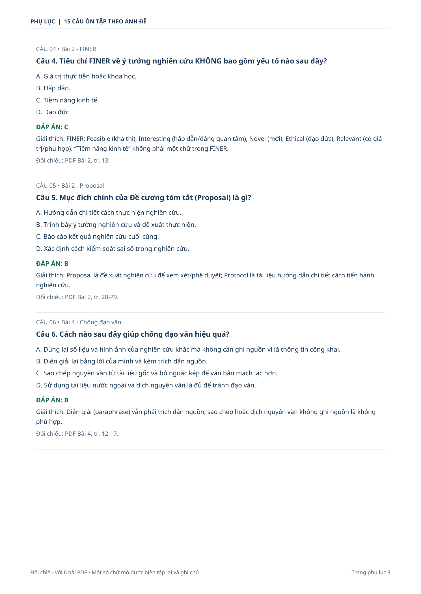

**PHỤ LỤC  |  15 CÂU ÔN TẬP THEO ẢNH ĐỀ** 

CÂU 04 • Bài 2 - FINER 

###### **Câu 4. Tiêu chí FINER về ý tưởng nghiên cứu KHÔNG bao gồm yếu tố nào sau đây?** 

A. Giá trị thực tiễn hoặc khoa học. 

B. Hấp dẫn. 

- C. Tiềm năng kinh tế. 

D. Đạo đức. 

###### **ĐÁP ÁN: C** 

Giải thích: FINER: Feasible (khả thi), Interesting (hấp dẫn/đáng quan tâm), Novel (mới), Ethical (đạo đức), Relevant (có giá trị/phù hợp). “Tiềm năng kinh tế” không phải một chữ trong FINER. 

Đối chiếu: PDF Bài 2, tr. 13. 

CÂU 05 • Bài 2 - Proposal 

###### **Câu 5. Mục đích chính của Đề cương tóm tắt (Proposal) là gì?** 

A. Hướng dẫn chi tiết cách thực hiện nghiên cứu. 

B. Trình bày ý tưởng nghiên cứu và đề xuất thực hiện. 

C. Báo cáo kết quả nghiên cứu cuối cùng. 

D. Xác định cách kiểm soát sai số trong nghiên cứu. 

###### **ĐÁP ÁN: B** 

Giải thích: Proposal là đề xuất nghiên cứu để xem xét/phê duyệt; Protocol là tài liệu hướng dẫn chi tiết cách tiến hành nghiên cứu. 

Đối chiếu: PDF Bài 2, tr. 28-29. 

CÂU 06 • Bài 4 - Chống đạo văn 

###### **Câu 6. Cách nào sau đây giúp chống đạo văn hiệu quả?** 

A. Dùng lại số liệu và hình ảnh của nghiên cứu khác mà không cần ghi nguồn vì là thông tin công khai. 

B. Diễn giải lại bằng lời của mình và kèm trích dẫn nguồn. 

C. Sao chép nguyên văn từ tài liệu gốc và bỏ ngoặc kép để văn bản mạch lạc hơn. 

D. Sử dụng tài liệu nước ngoài và dịch nguyên văn là đủ để tránh đạo văn. 

###### **ĐÁP ÁN: B** 

Giải thích: Diễn giải (paraphrase) vẫn phải trích dẫn nguồn; sao chép hoặc dịch nguyên văn không ghi nguồn là không phù hợp. 

Đối chiếu: PDF Bài 4, tr. 12-17. 

Đối chiếu với 6 bài PDF • Một số chữ mờ được biên tập lại và ghi chú 

Trang phụ lục 3

## Trang 16

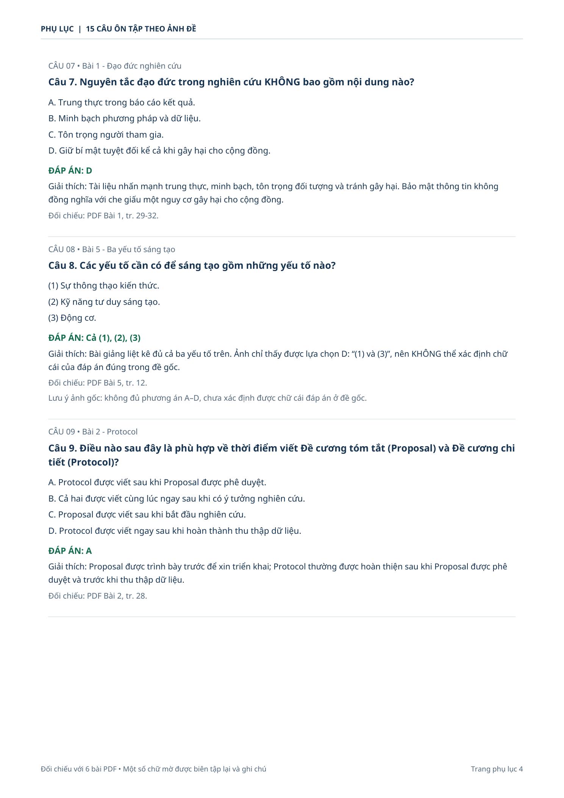

**PHỤ LỤC  |  15 CÂU ÔN TẬP THEO ẢNH ĐỀ** 

CÂU 07 • Bài 1 - Đạo đức nghiên cứu 

###### **Câu 7. Nguyên tắc đạo đức trong nghiên cứu KHÔNG bao gồm nội dung nào?** 

- A. Trung thực trong báo cáo kết quả. 

- B. Minh bạch phương pháp và dữ liệu. 

- C. Tôn trọng người tham gia. 

- D. Giữ bí mật tuyệt đối kể cả khi gây hại cho cộng đồng. 

###### **ĐÁP ÁN: D** 

Giải thích: Tài liệu nhấn mạnh trung thực, minh bạch, tôn trọng đối tượng và tránh gây hại. Bảo mật thông tin không đồng nghĩa với che giấu một nguy cơ gây hại cho cộng đồng. 

Đối chiếu: PDF Bài 1, tr. 29-32. 

CÂU 08 • Bài 5 - Ba yếu tố sáng tạo 

###### **Câu 8. Các yếu tố cần có để sáng tạo gồm những yếu tố nào?** 

- (1) Sự thông thạo kiến thức. 

- (2) Kỹ năng tư duy sáng tạo. 

- (3) Động cơ. 

###### **ĐÁP ÁN: Cả (1), (2), (3)** 

Giải thích: Bài giảng liệt kê đủ cả ba yếu tố trên. Ảnh chỉ thấy được lựa chọn D: “(1) và (3)”, nên KHÔNG thể xác định chữ cái của đáp án đúng trong đề gốc. 

Đối chiếu: PDF Bài 5, tr. 12. 

Lưu ý ảnh gốc: không đủ phương án A–D, chưa xác định được chữ cái đáp án ở đề gốc. 

CÂU 09 • Bài 2 - Protocol 

###### **Câu 9. Điều nào sau đây là phù hợp về thời điểm viết Đề cương tóm tắt (Proposal) và Đề cương chi tiết (Protocol)?** 

- A. Protocol được viết sau khi Proposal được phê duyệt. 

- B. Cả hai được viết cùng lúc ngay sau khi có ý tưởng nghiên cứu. 

- C. Proposal được viết sau khi bắt đầu nghiên cứu. 

- D. Protocol được viết ngay sau khi hoàn thành thu thập dữ liệu. 

###### **ĐÁP ÁN: A** 

Giải thích: Proposal được trình bày trước để xin triển khai; Protocol thường được hoàn thiện sau khi Proposal được phê duyệt và trước khi thu thập dữ liệu. 

Đối chiếu: PDF Bài 2, tr. 28. 

Đối chiếu với 6 bài PDF • Một số chữ mờ được biên tập lại và ghi chú 

Trang phụ lục 4

## Trang 17

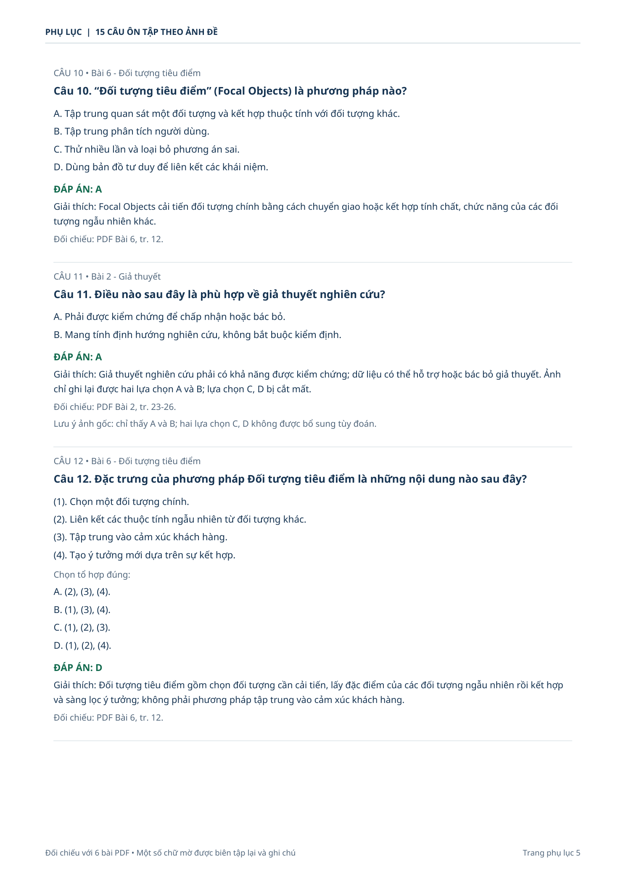

**PHỤ LỤC  |  15 CÂU ÔN TẬP THEO ẢNH ĐỀ** 

CÂU 10 • Bài 6 - Đối tượng tiêu điểm 

###### **Câu 10. “Đối tượng tiêu điểm” (Focal Objects) là phương pháp nào?** 

- A. Tập trung quan sát một đối tượng và kết hợp thuộc tính với đối tượng khác. 

- B. Tập trung phân tích người dùng. 

- C. Thử nhiều lần và loại bỏ phương án sai. 

- D. Dùng bản đồ tư duy để liên kết các khái niệm. 

###### **ĐÁP ÁN: A** 

Giải thích: Focal Objects cải tiến đối tượng chính bằng cách chuyển giao hoặc kết hợp tính chất, chức năng của các đối tượng ngẫu nhiên khác. 

Đối chiếu: PDF Bài 6, tr. 12. 

CÂU 11 • Bài 2 - Giả thuyết 

###### **Câu 11. Điều nào sau đây là phù hợp về giả thuyết nghiên cứu?** 

A. Phải được kiểm chứng để chấp nhận hoặc bác bỏ. 

B. Mang tính định hướng nghiên cứu, không bắt buộc kiểm định. 

###### **ĐÁP ÁN: A** 

Giải thích: Giả thuyết nghiên cứu phải có khả năng được kiểm chứng; dữ liệu có thể hỗ trợ hoặc bác bỏ giả thuyết. Ảnh chỉ ghi lại được hai lựa chọn A và B; lựa chọn C, D bị cắt mất. 

Đối chiếu: PDF Bài 2, tr. 23-26. 

Lưu ý ảnh gốc: chỉ thấy A và B; hai lựa chọn C, D không được bổ sung tùy đoán. 

CÂU 12 • Bài 6 - Đối tượng tiêu điểm 

###### **Câu 12. Đặc trưng của phương pháp Đối tượng tiêu điểm là những nội dung nào sau đây?** 

(1). Chọn một đối tượng chính. 

- (2). Liên kết các thuộc tính ngẫu nhiên từ đối tượng khác. 

- (3). Tập trung vào cảm xúc khách hàng. 

- (4). Tạo ý tưởng mới dựa trên sự kết hợp. 

Chọn tổ hợp đúng: 

A. (2), (3), (4). B. (1), (3), (4). C. (1), (2), (3). 

D. (1), (2), (4). 

###### **ĐÁP ÁN: D** 

Giải thích: Đối tượng tiêu điểm gồm chọn đối tượng cần cải tiến, lấy đặc điểm của các đối tượng ngẫu nhiên rồi kết hợp và sàng lọc ý tưởng; không phải phương pháp tập trung vào cảm xúc khách hàng. Đối chiếu: PDF Bài 6, tr. 12. 

Đối chiếu với 6 bài PDF • Một số chữ mờ được biên tập lại và ghi chú 

Trang phụ lục 5

## Trang 18

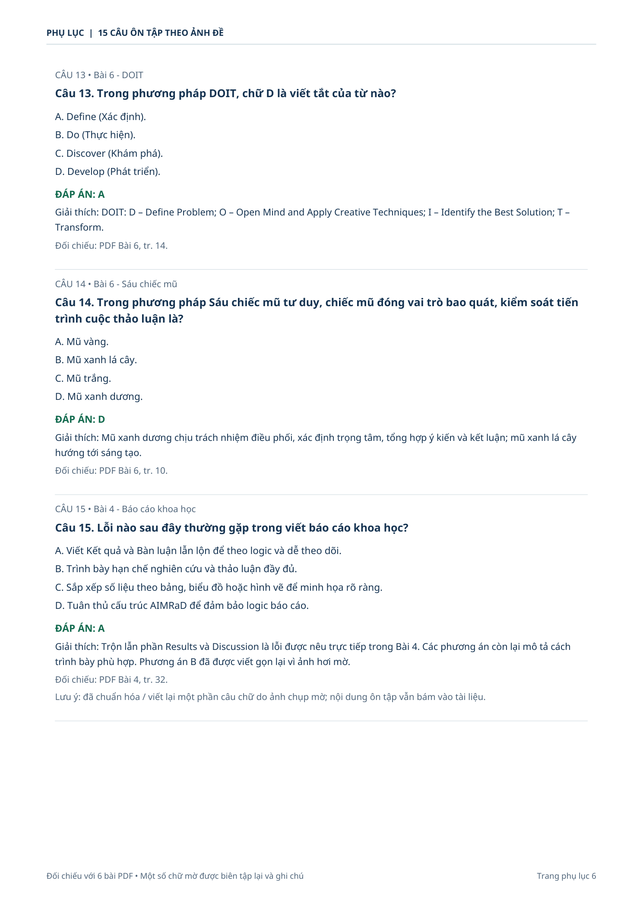

**PHỤ LỤC  |  15 CÂU ÔN TẬP THEO ẢNH ĐỀ** 

CÂU 13 • Bài 6 - DOIT 

###### **Câu 13. Trong phương pháp DOIT, chữ D là viết tắt của từ nào?** 

A. Define (Xác định). 

B. Do (Thực hiện). 

- C. Discover (Khám phá). 

- D. Develop (Phát triển). 

###### **ĐÁP ÁN: A** 

Giải thích: DOIT: D – Define Problem; O – Open Mind and Apply Creative Techniques; I – Identify the Best Solution; T – Transform. 

Đối chiếu: PDF Bài 6, tr. 14. 

CÂU 14 • Bài 6 - Sáu chiếc mũ 

###### **Câu 14. Trong phương pháp Sáu chiếc mũ tư duy, chiếc mũ đóng vai trò bao quát, kiểm soát tiến trình cuộc thảo luận là?** 

A. Mũ vàng. 

- B. Mũ xanh lá cây. 

- C. Mũ trắng. 

- D. Mũ xanh dương. 

###### **ĐÁP ÁN: D** 

Giải thích: Mũ xanh dương chịu trách nhiệm điều phối, xác định trọng tâm, tổng hợp ý kiến và kết luận; mũ xanh lá cây hướng tới sáng tạo. 

Đối chiếu: PDF Bài 6, tr. 10. 

CÂU 15 • Bài 4 - Báo cáo khoa học 

###### **Câu 15. Lỗi nào sau đây thường gặp trong viết báo cáo khoa học?** 

- A. Viết Kết quả và Bàn luận lẫn lộn để theo logic và dễ theo dõi. 

- B. Trình bày hạn chế nghiên cứu và thảo luận đầy đủ. 

- C. Sắp xếp số liệu theo bảng, biểu đồ hoặc hình vẽ để minh họa rõ ràng. 

D. Tuân thủ cấu trúc AIMRaD để đảm bảo logic báo cáo. 

###### **ĐÁP ÁN: A** 

Giải thích: Trộn lẫn phần Results và Discussion là lỗi được nêu trực tiếp trong Bài 4. Các phương án còn lại mô tả cách trình bày phù hợp. Phương án B đã được viết gọn lại vì ảnh hơi mờ. 

Đối chiếu: PDF Bài 4, tr. 32. 

Lưu ý: đã chuẩn hóa / viết lại một phần câu chữ do ảnh chụp mờ; nội dung ôn tập vẫn bám vào tài liệu. 

Đối chiếu với 6 bài PDF • Một số chữ mờ được biên tập lại và ghi chú 

Trang phụ lục 6
